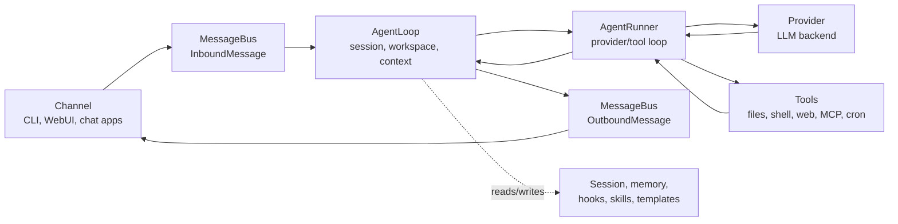
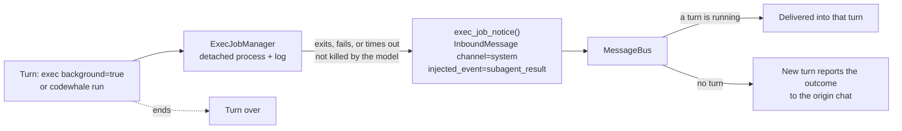

# Architecture

This page maps nanobot's runtime behavior to source files. Use it when you are debugging internals, reviewing a PR, adding a provider/channel/tool, or trying to understand where a user-visible behavior comes from.

For the product-level mental model, read [`concepts.md`](./concepts.md) first.

## Core Flow



Main files:

| Area | Files |
|---|---|
| Message events and queue | `nanobot/bus/events.py`, `nanobot/bus/queue.py` |
| Turn orchestration | `nanobot/agent/loop.py` |
| Provider/tool conversation loop | `nanobot/agent/runner.py` |
| Context construction | `nanobot/agent/context.py` |
| Session storage and compaction | `nanobot/session/manager.py` |
| Long-term memory and Dream | `nanobot/agent/memory.py` |

## Agent Loop vs Agent Runner

`AgentLoop` owns the channel-facing turn:

- receives inbound messages;
- determines the effective session and workspace scope;
- builds context;
- wires hooks, progress, and channel metadata;
- publishes outbound messages.

`AgentRunner` owns the model-facing loop:

- sends messages to the selected provider;
- handles streaming deltas and reasoning blocks;
- executes tool calls;
- feeds tool results back into the model;
- stops when a final answer is produced or runtime limits are hit.

The channel-facing loop enables a conservative premature-final guard in `nanobot/agent/premature_final.py`. It applies only when the latest user request asks for work and the draft final unconditionally promises remaining execution. Explanation-only requests, explicit plan-only or do-not-execute restrictions, optional offers, and a stated blocker pass through. A short approval such as “proceed” is grounded only in earlier conversation text; conversation-focus metadata never grants permission.

The guard does not treat successful tools, routing, `skill_decision`, or goal recording as proof that the whole task is done. On the first match it appends one hidden correction and continues within the remaining iteration budget. If the next final still promises unfinished work, the runner replaces it with an incomplete result and sets `stop_reason` to `incomplete`. The correction and incomplete text grant no new approval and do not move a staged workflow forward. The same replacement applies to a max-iteration fallback. Subagent runs leave the guard disabled.

Keep this split in mind when debugging. If a problem is about channel routing, session keys, workspace selection, or outbound delivery, start in `agent/loop.py`. If it is about provider calls, tool calls, streaming, iteration limits, or a promised action that ended without tool execution, start in `agent/runner.py` and `agent/premature_final.py`.

## Providers

Provider metadata is centralized in `nanobot/providers/registry.py`. Configuration fields live in `nanobot/config/schema.py`.

Provider selection uses:

- explicit `agents.defaults.provider` or preset provider;
- provider registry keywords;
- API key prefixes and API base URL hints;
- local provider fallback when `apiBase` is configured;
- gateway fallback for providers that can route many model families.

Provider implementations live in `nanobot/providers/`. Most hosted providers use the OpenAI-compatible implementation, while Anthropic, Azure OpenAI, AWS Bedrock, OpenAI Codex, and GitHub Copilot have specialized paths.

Useful docs:

- [`providers.md`](./providers.md) for practical setup;
- [`configuration.md#providers`](./configuration.md#providers) for exact provider reference.

## Channels

Channels translate external platforms into `InboundMessage` events and send `OutboundMessage` events back to the platform.

Main files:

| Area | Files |
|---|---|
| Base channel contract | `nanobot/channels/base.py` |
| Built-in channels | `nanobot/channels/*.py` |
| Discovery and lifecycle | `nanobot/channels/manager.py` |
| WebSocket/WebUI channel | `nanobot/channels/websocket.py` |

Channels are discovered through built-in module scanning and plugin entry points. A custom channel should follow [`channel-plugin-guide.md`](./channel-plugin-guide.md).

## WebUI and Gateway

`nanobot gateway` starts:

- enabled chat channels;
- the WebSocket channel when configured;
- workspace-scoped cron service;
- system jobs such as Dream and heartbeat;
- the health endpoint on `gateway.port`.

The packaged WebUI is served by the WebSocket channel, not the health endpoint:

| Surface | Default |
|---|---|
| Health endpoint | `http://127.0.0.1:18790/health` |
| WebUI/WebSocket | `http://127.0.0.1:8765` |

WebUI source lives in `webui/`. The production build is written to `nanobot/web/dist/` and bundled into the wheel.

Useful docs:

- [`webui.md`](./webui.md) for the WebUI user guide;
- [`../webui/README.md`](../webui/README.md) for frontend source development;
- [`websocket.md`](./websocket.md) for protocol details.

## Tools

Tools are discovered from `nanobot/agent/tools/` and plugin entry points.

Important files:

| Tool area | Files |
|---|---|
| Tool base and schema | `nanobot/agent/tools/base.py`, `nanobot/agent/tools/schema.py` |
| Discovery | `nanobot/agent/tools/registry.py` |
| Shell execution | `nanobot/agent/tools/shell.py` |
| Detached background jobs | `nanobot/agent/tools/exec_job.py` |
| Coding runs (opt-in) | `nanobot/agent/tools/codewhale.py` |
| Filesystem tools | `nanobot/agent/tools/filesystem.py` |
| Web search/fetch | `nanobot/agent/tools/web.py` |
| MCP tools | `nanobot/agent/tools/mcp.py` |
| Cron | `nanobot/agent/tools/cron.py`, `nanobot/cron/` |
| Image generation | `nanobot/agent/tools/image_generation.py` |
| Skill search | `nanobot/agent/tools/skill_search.py`, `nanobot/skill_store.py` |
| Subagent delegation | `nanobot/agent/tools/spawn.py`, `nanobot/agent/tools/delegate.py`, `nanobot/agent/subagent.py` |
| Runtime self-inspection | `nanobot/agent/tools/self.py` |

Tool behavior is part of the model contract. Keep user-visible tool names, schemas, and error messages stable unless a change is intentional.

A new built-in tool also needs entries in `nanobot/agent/tool_guidance.py` (`TOOL_GROUPS` and `SECTION_GROUPS`), or the compact prompt falls back to loading all guidance for any turn that uses it. Tools that change state belong in `INTENT_METADATA_REQUIRED_TOOLS` (or the conditional set) in `registry.py`, in `tool_action()` in `agent/context_control.py`, and, when they execute code, in the blocklists in `agent/tools/loader.py`.

## Background Jobs and Coding Runs

`exec` with `background=true` and the `codewhale` tool start a detached process that
outlives the turn. `ExecJobManager` in `exec_job.py` records the job, its log under
`<workspace>/.nanobot/exec-jobs/`, and the chat that started it (`ExecJob.origin`, taken
from the request context).



The notice reuses the sub-agent result path, so a repeated `exec-job-<id>` is recorded
once. A job with no request context (for example one started by a CLI script) sends no
notice. `exec_job status` still works for polling. When a job log shows the run was denied
permission, the notice and `codewhale status` say the work was not done even if the exit
code is 0.

`codewhale` is off by default (`tools.codewhale.enable=false`) and is registered per
instance. It runs `codewhale exec --auto` detached, one run per conversation and one per
workspace, under the same `tools.exec` deny/sandbox/PATH/env settings as `exec`; see
[`configuration.md#codewhale-tool`](./configuration.md#codewhale-tool). The model-facing
guidance in `templates/agent/tool_contract.md` prefers it for code edits only when the tool
is registered.

## Skills

Skills are loaded by `nanobot/agent/skills.py`. The loader merges three roots in
priority order:

1. system skills from `nanobot/skills-system/`;
2. workspace skills from `<workspace>/skills/`;
3. built-in skills from `nanobot/skills/`.

System skills are repository-managed orchestration skills. Built-in skills are
packaged task workflows. Workspace skills are instance-local custom workflows.
The WebUI Skills API (`nanobot/webui/skills_api.py`) exposes safe summaries and
detail payloads from the same loader.

The workspace skill registry lives in `nanobot/skill_store.py`. It stores skill
metadata, search rows, routing traces, outcome counters, and lifecycle status.
The CLI commands under `nanobot skill ...` rebuild and inspect that registry.
`skill_search` uses the registry at runtime to find focused instructions without
injecting every skill into each prompt. Ranking uses SQLite FTS5 (BM25) by
default; semantic embeddings are used only when `skills.embedding` is configured.
Only `candidate` and `verified` skills are searchable; drafts are excluded.
The model records its final choice with `skill_decision`. Search rank, routing
tests, and a recorded decision are hints, not proof that the skill was applied
or that the task finished. Routing tests run only when `nanobot skill test-routing`
is invoked.

Skill management writes are centralized in the same skill store service. The CLI
and WebUI management API (`nanobot/webui/skill_manage_api.py`) both call that
service for draft approval, candidate promotion, deprecation, rejection,
Minor/Major edit assessment, routing tests, and system-skill write protection.
The older read-only catalog API (`nanobot/webui/skills_api.py`) remains separate
so the management routes can stay capability-gated under `/api/skills/manage`.

Subagent orchestration reuses the normal agent loop with a narrower context.
`spawn` runs asynchronously and announces completion through the bus.
`delegate` runs synchronously and returns the result to the parent tool call.
Subagent profiles are configured in `agents.defaults.subagentProfiles` and are
enforced by `SubagentManager`.

## Config and Paths

The config schema lives in `nanobot/config/schema.py`. Loading and saving live in `nanobot/config/loader.py`. Runtime path helpers live in `nanobot/config/paths.py`.

Defaults:

| Path | Default |
|---|---|
| Config | `~/.nanobot/config.json` |
| Workspace | `~/.nanobot/workspace/` |
| Sessions | `<workspace>/sessions/*.jsonl` |
| Memory | `<workspace>/memory/` |
| Cron store | `<workspace>/cron/jobs.json` |
| WebUI/media/log runtime data | config directory subdirectories such as `webui/`, `media/`, and `logs/` |

The schema accepts both camelCase and snake_case keys, but saves config with camelCase aliases.

## Memory and Sessions

Session history is the near-term conversation replay. Memory is the longer-term workspace state.

| Store | File area |
|---|---|
| Session JSONL files | `<workspace>/sessions/` |
| Long-term memory | `<workspace>/memory/MEMORY.md` |
| Consolidation source history | `<workspace>/memory/history.jsonl` |
| Bootstrap identity files | `<workspace>/SOUL.md`, `<workspace>/USER.md`, templates under `nanobot/templates/` |

Dream is implemented in `nanobot/agent/memory.py` and scheduled by the runtime when enabled.

Consolidation and compaction never mark text as processed unless it was summarized:

- token-triggered and replay-window consolidation summarize up to the largest user-turn
  boundary that fits the input budget and advance the cursor only that far;
- replay overflow is judged in real tokens, the same way `Session.get_history()` trims;
- `history.jsonl` compaction keeps the recent window and anything the Dream cursor has not
  passed, so an unprocessed backlog may exceed `max_history_entries`;
- history is cut only at a real turn start (`session/history_visibility.py ::
  is_turn_start_message`), never at the hidden task-control message stored after a request.

## Prompt Weight

The default prompt is kept small (`agents.defaults.compactContext=true`,
`memoryPromptTokens=5000`, `memoryPromptAutoRefresh=true`):

| Piece | Files | Behavior |
|---|---|---|
| Deferred tools | `agent/compact_context.py` | Execution tutorials and tool schemas load on `activate_tools`; the names a turn activated seed the next turn so the system message does not change mid-turn |
| Tool-group guidance | `agent/tool_guidance.py` | Only the guidance of the selected built-in tool groups is composed; an unclassified tool loads everything |
| Bounded memory summary | `agent/memory_prompt.py`, `agent/memory_prompt_refresh.py` | A reviewed summary of `MEMORY.md` replaces the raw file only when it is actually smaller: a literal copy of the memory is served as the raw text without the "condensed" notice, and a snapshot that is not smaller than the raw file is ignored quietly. A missing, damaged or over-budget snapshot falls back to the raw file with a warning |
| Usage measurement | `providers/usage_ledger.py` | One content-free line per provider attempt; `NANOBOT_DEBUG_CACHE_FINGERPRINT=1` adds structural hashes for cache-miss diagnosis |

Details and tradeoffs: [`design/compact-context.md`](./design/compact-context.md),
[`design/selective-memory.md`](./design/selective-memory.md),
[`design/memory-archive.md`](./design/memory-archive.md).

The conversation event store and memory search live in `nanobot/memory/`
(`event_store.py`, `search.py`, `task_context.py`). `privacy.py` provides
explicit forget/purge operations; no automatic redaction of sensitive content at
write time is implemented there.

## Opt-in Execution Paths

These paths have similar names but are separate features. Each is off in the
schema defaults, and a local instance's settings are not product defaults.

| Path | Files | Default and activation |
|---|---|---|
| Ordinary agent loop | `agent/loop.py`, `agent/runner.py`, `agent/premature_final.py` | Always the default response path |
| Intent-first context selection | `agent/context_selection.py` | `agents.defaults.contextSelection.enabled=false`; asks for confirmation when a mutation target is ambiguous |
| Time-allocation contract | `agent/time_allocation.py` | `contextSelection.timeAllocationContractEnabled=false`; takes effect only on the context-selection path |
| Stepwise reasoning | `nanobot/reasoning/` | `stepwise.enabled=false`; applied per agent with `nanobot stepwise apply`; per-run defaults 120 s and 8 model calls |
| Retrieval evidence packets | `nanobot/evidence/`, `agent/tools/web.py` | `tools.web.evidence.enabled=false`; packets rank candidates and never verify claims |
| Durable workflow | `nanobot/workflow/`, `agent/tools/workflow.py` | `tools.workflow.enabled=false` |
| Codewhale coding runs | `agent/tools/codewhale.py` | `tools.codewhale.enable=false`; needs a Codewhale binary and, usually, an LLM relay client |

The prompt-weight settings above are different: they are on by default, and a local
instance can turn them off.

## Gateway Runtime and Restart

A background gateway is tracked by a state file under `<config dir>/run/` (one per
config and workspace) with its PID, a process start identity, port and command
(`nanobot/gateway/runtime.py`). The identity is compared instead of the PID alone; a state
whose identity cannot be verified shows as `identity_unverified` and is never started,
stopped or restarted automatically. Details:
[`design/gateway-runtime-identity.md`](./design/gateway-runtime-identity.md).

`nanobot up`, `down` and `restart` (`nanobot/cli/up.py`) are the launcher commands. A
restart:

1. refuses to run inline from inside the gateway's own process tree and instead schedules a
   detached restart a few seconds later (the running turn is cancelled and does not resume);
2. checks, before stopping anything, that the new gateway can start: the port it will use is
   free or held by the gateway being restarted, and the config loads in the current
   environment (an unset `${VAR}` aborts the restart);
3. stops the gateway and starts it again **on the port the old one was using**, not on the
   config's `gateway.port`, because several instance configs share that value and take their
   real port from `--port`.

The restart-only environment variables (`NANOBOT_ALLOW_SELF_STOP`,
`NANOBOT_DETACHED_RESTART`) are never passed to the new gateway.

## Pinned Runtime

`scripts/runtime.sh` with `scripts/runtime_launcher.py` runs one instance from a
clean checkout of a verified commit, using one profile per instance. See
[`../deploy/README.md`](../deploy/README.md).

## Security Boundaries

Security-sensitive code paths include:

| Boundary | Files |
|---|---|
| Workspace scope | `nanobot/security/workspace_access.py`, `nanobot/security/workspace_policy.py` |
| Shell sandboxing | `nanobot/agent/tools/shell.py` |
| SSRF/network checks | `nanobot/security/network.py`, `nanobot/agent/tools/web.py` |
| PTH guard and CLI startup security | `nanobot/security/` and CLI entrypoints |
| Channel access control | channel config in `nanobot/channels/*.py` |

When changing tools, channels, file access, WebUI workspace behavior, or network fetching, treat security as part of the functional behavior and update docs if the user-facing boundary changes.

## Extension Points

| Extension | How |
|---|---|
| Provider | Add `ProviderSpec` in `providers/registry.py`, add schema field in `config/schema.py`, implement provider only if the generic backend is not enough |
| Channel | Implement `BaseChannel`, expose an entry point, follow [`channel-plugin-guide.md`](./channel-plugin-guide.md) |
| Tool | Implement a tool under `agent/tools/` or expose a plugin entry point |
| MCP | Add `tools.mcpServers` config |
| Skill | Add workspace skill files under `<workspace>/skills/` or built-in skills under `nanobot/skills/` |

Prefer existing registry/discovery patterns over ad hoc wiring.

## Testing and Verification

Common checks:

```bash
pytest tests/test_openai_api.py::test_function -v
ruff check nanobot/
cd webui && bun run test
cd webui && bun run build
```

Choose tests based on the changed surface:

| Change | Minimum useful verification |
|---|---|
| Provider behavior | Provider unit tests or a mocked API path; `nanobot agent -m "Hello!"` with safe config when possible |
| Channel behavior | Channel tests plus `nanobot gateway` startup path |
| WebUI behavior | WebUI tests/build and, for routing/settings/chat changes, browser-level verification through the gateway |
| Tool behavior | Tool unit tests and an agent-run path when schema or model-facing behavior changes |
| Docs | Link checks, command accuracy against CLI/schema, and `git diff --check` |

For user-facing flows, prefer at least one verification path through the public surface the user actually touches: CLI command, HTTP endpoint, WebSocket/WebUI, chat channel, or packaged import.
